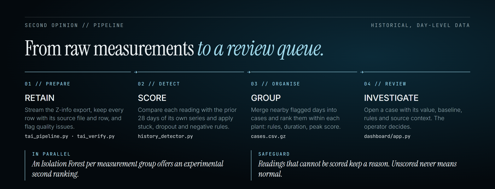
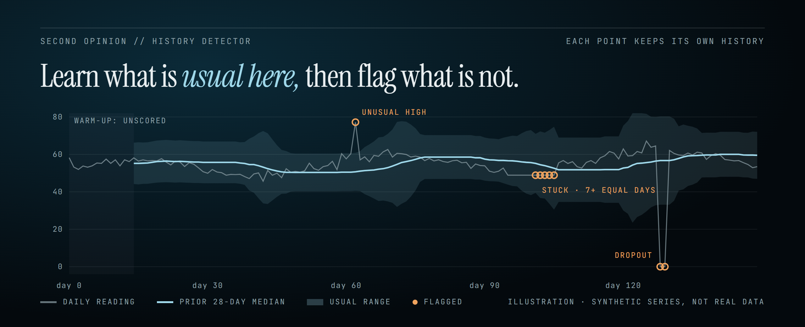

<p align="center">
  
</p>

<p align="center">
  
  
  
  
  
</p>

<p align="center">
  <a href="https://sunilparameswaran.github.io/Second_Opinion/">Website</a> ·
  <a href="#why">Why</a> ·
  <a href="#how-it-works">How it works</a> ·
  <a href="#quick-start">Quick start</a> ·
  <a href="#interpreting-results">Interpreting results</a> ·
  <a href="#documentation">Docs</a> ·
  <a href="#team">Team</a>
</p>

---

**Second Opinion** helps wastewater treatment operators decide which unusual measurements are worth checking first. It compares each daily reading with the recent history of **the same measurement point**, flags readings that deviate or look like a broken sensor, groups flagged days into cases, and ranks them **per plant**. An experimental Isolation Forest adds a second, independent ranking.

It is built around measurement data from **TAI's Z-info platform**. The aim is to help TAI and the plant operators who use Z-info catch readings that existing limit-based validation lets through, and to help them spend review time where it matters most.

**This repository contains no TAI, Z-info or plant data.** Every example, illustration and figure in it is synthetic, and the whole pipeline can be run on a [fully simulated export](docs/simulation/README.md).

Second Opinion supports the operator's judgement and does not replace it. A flag is a reason to look, not a diagnosis, a confirmed fault or proof that everything else is fine.

## Why

Plants record thousands of measurements every day, and most validation relies on fixed limits. Two problems follow:

- **A reading can be unusual for its own point while staying inside a fixed limit.** Limit checks pass it; the operator never sees it.
- **Review time is finite.** Every unnecessary investigation costs attention, so a useful tool has to rank, not just alarm.

The data has no confirmed anomaly labels, so Second Opinion is built to be transparent rather than clever. Every flag shows the value, the historical median, the robust spread, the rule that fired and the source row it came from.

## How it works

<p align="center">
  
</p>

| Stage | What it does | Code |
| --- | --- | --- |
| **Prepare** | Streams a Z-info table export (`Installations`, `MeasurementPoints`, `MeasurementValues`), keeps every row with its source file and row number, parses dates and values, and flags quality issues without deleting, imputing or converting anything. | [`src/data_prep/`](src/data_prep/) |
| **Detect** | Scores each reading against the prior 28 days of its own series using a rolling median and a floored MAD spread, with thresholds calibrated per series. Rules catch stuck sensors, dropouts to zero and negative values. | [`src/history_detector/`](src/history_detector/) |
| **Group** | Merges nearby flagged days into cases and ranks them within each plant: rule hits first, then duration, then peak score. | [`src/history_detector/`](src/history_detector/) |
| **Second view** | Fits one Isolation Forest per measurement group on six history-based features, trained chronologically (train ≤ 2023, validate 2024, hold out 2025). | [`src/isolation_forest/`](src/isolation_forest/) |
| **Review** | A local web dashboard shows flagged readings, their history and the evidence, in Dutch or English, with an optional Claude explanation. | [`dashboard/`](dashboard/) |

<p align="center">
  
</p>

The pipeline covers six exploratory measurement groups: influent volume, and activated-sludge oxygen, ammonium, nitrate, suspended solids and temperature. Each is a narrow metadata filter, not every reading of that type. Plants are never compared with each other, because they differ in geography, process and timing, and each has its own operator.

See the [methodology](docs/methodology.md) for the full method, design choices and limitations, or [step through each stage interactively](https://sunilparameswaran.github.io/Second_Opinion/pipeline/) on synthetic data.

## Quick start

### 1. Install

Use Python 3.11, the version in `.python-version` (tools such as `uv` and `pyenv` pick it up). From the repository root:

```bash
python3 -m venv .venv
source .venv/bin/activate          # Windows PowerShell: .venv\Scripts\Activate.ps1
python -m pip install -r requirements.txt
```

`requirements.txt` pins every package, including the ones the direct dependencies install, so a fresh environment matches the one the results were made with. To upgrade, change the pins deliberately and rerun the tests.

### 2. Provide data

Second Opinion reads a **Z-info table export** of daily measurements. No data ships with this repository. Place your export at:

```text
data/tai/extracted/
├── Installations/*.csv.gz
├── MeasurementPoints/*.csv.gz
└── MeasurementValues/*.csv.gz
```

`data/` is git-ignored. Measurement data, prepared files, scores and fitted models are derived from operational data, so keep them local and never commit them.

No access to the export? [Generate a fully simulated one](docs/simulation/README.md) with the same schema and known, injected anomalies: `python src/simulation/simulate_tai.py`, which writes straight into `data/tai/` so the rest of the pipeline and the dashboard work unchanged. Add `--workers N` to generate N plants at once (see [Running in parallel](#running-in-parallel)).

### 3. Run the pipeline

```bash
python src/pipeline.py --plan                           # show what would run or be skipped
python src/pipeline.py --smoke 30                       # quick partial run, 30 points per group
python src/pipeline.py                                  # full run
python src/pipeline.py --groups oxygen --force detect   # redo oxygen detection and downstream
python src/pipeline.py --with-faults                    # add the artificial-fault evaluation
python src/pipeline.py --workers 8 --jobs 3             # run in parallel (see Running in parallel below)
```

The driver fingerprints each stage's script, arguments and upstream stages in `data/tai/pipeline_state.json` and skips stages that are already complete and unchanged. It never deletes output: anything that must be redone is first renamed `<name>.old-<timestamp>`. Outputs and one log per stage go to `data/tai/pipeline/` (or `data/tai/pipeline_smoke<N>/`). Full preparation needs substantial time and disk space. A full run ends by building the dashboard's results index (`data/tai/second_opinion_web_index.sqlite`) with the dashboard's own code, so connecting the dashboard to `data/tai/pipeline` reuses it instead of indexing again. Smoke runs leave the shared index alone; the dashboard indexes a smoke folder when it connects. While it runs, the driver keeps one status line at the bottom of the terminal: with one stage running it shows that stage's own progress (files and rows for preparation and verification, numbered steps for the detectors and forests, rows for the dashboard index), and with several it shows the overall share and each running stage. Started and finished messages print above it, and every stage's own output goes to its log. Run on their own, the scripts (and the simulator) show their bar directly.

#### Running in parallel

Everything runs one thing at a time by default. Three settings run work side by side to save time. None of them changes any output; they only use more of the computer.

| Setting | What runs at the same time | Mainly uses |
| --- | --- | --- |
| `simulate_tai.py --workers N` | Up to N simulated plants are generated, each in its own process | CPU cores |
| `pipeline.py --workers N` | The prepare stage cleans up to N raw files, each in its own process | CPU cores, plus temporary disk space |
| `pipeline.py --jobs N` | Up to N pipeline stages that do not depend on each other | Memory |

`--workers` speeds up the work inside one step. Prepare's last part, the cross-file quality index and duplicate reports, still runs in one process.

`--jobs` decides how many stages can overlap, within the order they depend on each other:

- Prepare and verify always run alone, because every later stage needs them.
- After verify, the history check of each measurement group can start. Each group's Isolation Forest waits for its own history check, and the dashboard index waits for all the forests. With `--with-faults`, the artificial-fault comparisons only need verify.
- So with the six groups, at most six stages can run at once, one per group (twelve with `--with-faults`); a higher `--jobs` has no further effect.

Apart from prepare with `--workers`, each stage runs in a single process, and each history check holds its whole measurement group in memory. Memory is therefore what limits `--jobs`.

Choosing values:

- `--workers`: up to the number of physical CPU cores, leaving one or two free for the rest of the computer. For example, 8 on a 10-core machine.
- `--jobs`: start with 2 or 3, watch memory while the history checks run, and raise it only if plenty is left free.

The two settings never compete, because prepare runs before any other stage starts, so set both at once: `python src/pipeline.py --workers 8 --jobs 3`.

### 4. Open the dashboard

```bash
python dashboard/server.py
```

Open http://127.0.0.1:8518 and click **Connect results**; it reads `data/tai/pipeline/` by default. See the [dashboard guide](dashboard/README.md) for other result folders and the optional Claude explanation.

### 5. Run the tests

```bash
python -B -m unittest discover -s tests -t . -v
python -B -m unittest discover -s dashboard -p "test_*.py" -v
node --test dashboard/test_assistant_ui.cjs      # dashboard frontend, needs Node.js
```

All tests use small artificial fixtures, never real measurements.

## Interpreting results

- **History score:** distance from the point's prior median, in robust spreads. It is not a probability or a severity.
- **Rules:** stuck, dropout and negative are data-quality prompts, independent of the score.
- **Unscored:** every unscored reading carries a reason (insufficient history, same-day duplicates, invalid value, constant zero, …). Unscored never means normal.
- **Isolation Forest score:** a higher score means a rarer combination of features. It is not a fault probability, and scores from different group models are not comparable.
- **Evaluation:** the comparisons between the two methods are descriptive and use the same per-plant daily review budget. Recovery of artificial faults is not real-world accuracy. Without labelled incidents or expert review, Second Opinion makes **no claims** about precision, recall, false-alarm reduction or time saved.

## Documentation

The guides are also published on the [website](https://sunilparameswaran.github.io/Second_Opinion/docs/), rendered from the markdown below.

| Guide | Covers |
| --- | --- |
| [Methodology](docs/methodology.md) | Problem framing, the full method, design decisions and limitations |
| [Data preparation](docs/data_prep/README.md) | Input format, preparation outputs, verification and supplementary reports |
| [History detector](docs/history_detector/README.md) | Measurement groups, scoring, rules, cases, options and the artificial-fault evaluation |
| [Isolation Forest](docs/isolation_forest/README.md) | Features, eligibility, chronological splits, thresholds and the budget comparison |
| [Simulated dataset](docs/simulation/README.md) | A generated stand-in for the export, with injected anomalies and an answer key |
| [Dashboard](dashboard/README.md) | The local review workspace, its results layout and the optional Claude explanation |
| [Website](docs/website/) | The public site: landing page, interactive pipeline walk-through and these guides, published to [GitHub Pages](https://sunilparameswaran.github.io/Second_Opinion/) |

## Repository layout

```text
src/pipeline.py              Pipeline driver
src/dashboard_index.py       Prebuilds the dashboard index (last pipeline stage)
src/progress_bar.py          Shared terminal progress line used by the pipeline and its scripts
src/data_prep/               Preparation, verification and data reports
src/history_detector/        History detector and artificial-fault evaluation
src/isolation_forest/        Experimental Isolation Forest
src/simulation/              Simulated Z-info export generator
dashboard/                   Local web dashboard (Python server, JavaScript frontend)
tests/                       Synthetic-fixture tests
docs/                        Methodology, component guides and README graphics
docs/website/                Project website source (GitHub Pages)
data/                        Local data and outputs (git-ignored)
```

## Status and limitations

Second Opinion is a research prototype run on historical, day-level data. It is not a live alerting system. Measurement meanings, units, reporting periods and observation availability still need to be confirmed with TAI. The thresholds encode an assumed review workload, roughly 1% of readings, not a validated false-alarm rate. Next steps would be expert review of a documented sample of flagged and unflagged cases, persistent operator feedback, and a comparison against the validation limits that actually applied at the time.

## Team

Built by
[Joshua Varghese Thomji](https://github.com/josh1221wa),
[Sunil Parameswaran](https://github.com/SunilParameswaran),
[S Smriti](https://github.com/smritis21) and
[Oindrilla Banerjee](https://github.com/oindrilla007).
